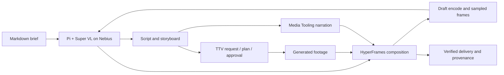

# Production architecture

## Components

The user supplies a Markdown brief to Pi. A project-local provider extension
registers Nemotron 3.5 Super VL using Pi's existing OpenAI Chat Completions
implementation. Pi owns the agent loop, tools, session persistence and compaction.
The extension observes route, image-input counts, tool completion, stop reasons
and usage; it stores neither prompt content nor reasoning in its metadata ledger.
Pi's native transcripts can contain private input and reasoning and stay ignored.

Before each Nebius request, the adapter enforces the endpoint's eight-image limit
across replayed history. It sends the newest eight images and replaces older
image blocks with explicit textual omission markers. This adapts a request copy;
native session records, tool-call identities, prior review text and source files
remain intact. The ledger records image counts before/after adaptation and the
number omitted. Model metadata declares the limit; Pi 1.1.0 does not enforce that
metadata itself, so the project adapter applies it. Review new images in batches
of at most eight and reopen older sources when needed.

The model directs the workflow using `read`, `bash`, `edit` and `write`:

The existing toolkit sources remain in `/Users/magos/dev/media-tooling` and
`/Users/magos/dev/kumanday/ttv-pipeline`. Local installed commands are preferred.
Record their Git revisions and command versions before production. Do not copy
their implementations into this workspace.

## Provider configuration

`configs/nebius.json` supplies the exact regional endpoint and model ID provided
by the user. Credentials resolve only from `NEBIUS_API_KEY`. No global provider
record is modified. `.pi/settings.json` makes this the project's default model;
`scripts/start-pi` explicitly selects it and limits extension discovery to the
project provider extension for the launch.

The model record uses a conservative operational context allowance of 262,144
tokens and a 32,768-token per-response allowance. These are configuration choices,
not measured endpoint limits or a total study/spending cap. Input/output price
estimates are $0.30/$0.90 per million tokens from Nebius's October 16 announcement.
Cached input is conservatively estimated at the normal input rate until its
actual pricing is verified. Pi cost totals are estimates, not invoices.

The route uses system messages and `max_tokens`. A live probe accepted
`reasoning_effort: high` and returned reasoning-token accounting. Acceptance does
not establish how the server interprets effort levels. The real Pi smoke checks
streaming, usage, visual input, read/write calls and tool-result replay. Long
contexts, native video transport and maximum output limits remain untested.

## Existing TTV handoff

Read `/Users/magos/dev/media-tooling/docs/generated-media.md` and the
motion-graphics skill's `references/generated-film-playbook.md` before execution.
Use the existing file adapter to avoid deploying services for this demo:

1. Export reviewed scenes with stable IDs into the existing storyboard JSON.
2. `media-generated request` and `send request --handoff` create an immutable
   request. Archive review evidence and its hashes.
3. The installed skill's `scripts/ttv_round.py plan` invokes TTV's file adapter
   and imports its plan. Review exact variants, prompts, references and quote.
4. Approve selected variants within the cumulative budget. Generate/review
   keyframes first where needed, then cite the reviewed keyframes for video.
5. Execute and import results through the same helper or documented native
   commands. Credentials travel in the environment or a pipe, not YAML on disk.
6. Freeze take selection with `media-generated select`. Keep immutable IDs and
   source/result hashes. Import selected clips as HyperFrames content layers.

The helper currently defaults to approving every variant if none is specified,
and enables unknown costs. Always pass explicit reviewed variants and establish
a credible cost ceiling first. Do not infer dollars from raw provider units.

## Visual review and delivery

Nemotron reads real storyboard cells and sampled frames using Pi's image-capable
`read` tool. Retain scene IDs, exact frame timestamps, image hashes, concrete
feedback and dispositions. Timecoded sequences support temporal review; stills
alone establish layout only. Inspect motion boundaries and audio separately.
Record a labeled review test if testing a seeded defect on a copy.

Use the installed HyperFrames authoring contract and seekable timelines. Narration
uses `media-tts`/`media-tts-frames`; footage remains muted. Run the toolchain's
checks, inspect an actual draft encode, repair named issues and render the final
file. `media-verify` supplements visual and listening review.

Provenance connects the final file hash to its brief, source composition, reviewed
frames, selected takes, Pi session identifiers and route/usage metadata. Export a
small sanitized evidence record. Do not publish raw session transcripts, private
paths, credentials, signed asset URLs or hidden reasoning.

## Public reproducibility

The local demo may use existing absolute checkout paths. Before publication,
expose them through documented configuration, add an owner-approved open source
license, pin dependencies, and package source plus permitted media or retrieval
instructions. A fresh example run is the acceptance check. EBO integration and
hosted infrastructure are later additions.
